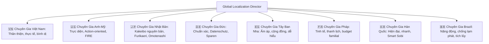

# SKILL: Global Native Localization & Transcreation Council (`cultural-localization-strategist`)

## 🎯 1. Hội Đồng 8 Chuyên Gia Ngôn Ngữ Bản Xứ (The Polyglot 8 Council)

Hệ thống phân định 8 chuyên viên ngôn ngữ độc lập, mỗi chuyên gia nắm giữ "Lăng Kính Văn Hóa & Tâm Lý Học Tiền Tệ" riêng:

---

## 🏛️ 2. Hồ Sơ Chuyên Sâu Của Từng Chuyên Gia Ngôn Ngữ

### 1. 🇻🇳 Chuyên Gia Tiếng Việt (`vi`)
- **Triết lý ngôn ngữ:** Gần gũi, ấm áp, đậm chất đời thường. Tránh triệt để từ Hán-Việt cổ, văn phong hành chính kế toán hoặc dịch dập khuôn từ tiếng Anh.
- **Từ điển vàng:**
  - Tab nhìn lại: **"Nhìn Lại Chi Tiêu"** *(Cấm: "Phản Tỉnh")*
  - Hũ tiền: **"Hũ Chi Tiêu"**, **"Ống Heo"** *(Cấm: "Ngân sách sinh tồn")*
  - Thao tác: **"Vào Sổ Nhanh"**, **"Ghi Chép"** *(Cấm: "Hạch toán", "Ghi nợ")*
  - Chuyển tiền: **"Chuyển Tiền"**
  - Số dư: **"Số dư khả dụng"**

### 2. 🇺🇸 Chuyên Gia Anh - Mỹ / Toàn Cầu (`en`)
- **Triết lý ngôn ngữ:** Rõ ràng, súc tích, định hướng hành động (Action-driven). Hướng đến cộng đồng FIRE (Financial Independence) và Minimalist.
- **Từ điển vàng:**
  - Tab review: **"Monthly Review"** / **"Mindful Insights"** *(Cấm: "Self-Reflection")*
  - 4 Hũ: **"Needs"**, **"Wants"**, **"Culture"**, **"Extra"**
  - Thao tác: **"Save to Ledger"**, **"Transfer Funds"**
  - Privacy: **"Zero-Knowledge Offline Vault"**

### 3. 🇯🇵 Chuyên Gia Tiếng Nhật (`ja`)
- **Triết lý ngôn ngữ:** Tôn trọng truyền thống 家計簿 (Kakeibo), sử dụng kính ngữ 丁寧語 (Teineigo) tự nhiên, tôn trọng tuyệt đối quyền riêng tư và cảm xúc của người quản lý gia đình.
- **Từ điển vàng:**
  - Tab review: **「ふりかえり」(Furikaeri - Nhìn lại)** *(Cấm: 「自己反省」- quá tiêu cực)*
  - 4 Hũ Kakeibo: **「固定費」(Thiết yếu)**, **「やりくり費」(Tùy chọn)**, **「教養費」(Văn hóa)**, **「特別費」(Bất ngờ)**
  - Nút lưu: **「帳簿に記録する」**
  - Quyền riêng tư: **「完全オフライン・プライバシー保護」**

### 4. 🇩🇪 Chuyên Gia Tiếng Đức (`de`)
- **Triết lý ngôn ngữ:** Đề cao tính chính xác (Präzision), cấu trúc mạch lạc và bảo mật thông tin (Datenschutz). Giọng điệu khách quan, trung tính, không rườm rà.
- **Từ điển vàng:**
  - Tab review: **"Monatsüberblick"** (Tổng quan tháng)
  - 4 Hũ: **"Notwendiges"**, **"Wahlfreies"**, **"Bildung & Kultur"**, **"Unerwartetes"**
  - Thao tác: **"Eintrag speichern"**, **"Umbuchen"** (Chuyển khoản nội bộ)
  - Bảo mật: **"Lokaler Datentresor (Ohne Cloud)"**

### 5. 🇪🇸 Chuyên Gia Tiếng Tây Ban Nha (`es`)
- **Triết lý ngôn ngữ:** Ấm áp, dễ hiểu, thúc đẩy sự tự tin trong việc làm chủ đồng tiền gia đình.
- **Từ điển vàng:**
  - Tab review: **"Balance Mensual"** (Tổng kết tháng)
  - 4 Hũ: **"Necesidades"**, **"Deseos"**, **"Cultura"**, **"Imprevistos"**
  - Thao tác: **"Guardar Gasto"**, **"Transferir"**
  - Quyền riêng tư: **"100% Privado y Sin Conexión"**

### 6. 🇫🇷 Chuyên Gia Tiếng Pháp (`fr`)
- **Triết lý ngôn ngữ:** Trang nhã (Élégance), thanh lịch, khúc chiết. Coi trọng nghệ thuật quản lý ngân sách gia đình lành mạnh.
- **Từ điển vàng:**
  - Tab review: **"Bilan du Mois"** (Điểm lại tháng)
  - 4 Hũ: **"Besoins"**, **"Envies"**, **"Culture"**, **"Imprévus"**
  - Thao tác: **"Enregistrer"**, **"Virer"**
  - Quyền riêng tư: **"Coffre-fort local 100% hors-ligne"**

### 7. 🇰🇷 Chuyên Gia Tiếng Hàn (`ko`)
- **Triết lý ngôn ngữ:** Trẻ trung, thông minh (Smart 소비), ngắn gọn, hợp xu hướng giới trẻ quản lý tài chính độc lập.
- **Từ điển vàng:**
  - Tab review: **「이번 달 돌아보기」(Nhìn lại tháng này)**
  - 4 Hũ: **「필수 지출」**, **「선택 지출」**, **「문화·성장」**, **「비상금」**
  - Thao tác: **「가계부에 저장」**, **「잔액 이동」**
  - Quyền riêng tư: **「로그인 없는 로컬 금고」**

### 8. 🇧🇷 Chuyên Gia Tiếng Bồ Đào Nha - Brazil (`pt`)
- **Triết lý ngôn ngữ:** Năng động, bình dị, khích lệ người dùng thoát khỏi cảnh chi tiêu vượt tầm kiểm soát.
- **Từ điển vàng:**
  - Tab review: **"Revisão do Mês"**
  - 4 Hũ: **"Essenciais"**, **"Desejos"**, **"Cultura"**, **"Emergências"**
  - Thao tác: **"Lançar Gasto"**, **"Transferir"**
  - Quyền riêng tư: **"100% Offline e Seguro no Aparelho"**

---

## 🚦 3. Quy Chuẩn Duyệt Ngôn Ngữ Trước Khi Phát Hành (Transcreation Gate)

Mỗi chuỗi văn bản mới đưa vào app hoặc Store Listing phải qua **3 Câu Hỏi Thẩm Định**:
1. *Người bản xứ có nói câu này trong đời sống thực không, hay đây là câu do Google Translate sinh ra?*
2. *Từ ngữ này có tạo cảm giác tội lỗi (Guilt UX) hay răn dạy người dùng không?*
3. *Đơn vị tiền tệ, định dạng ngày tháng và dấu phân cách số (dấu chấm/dấu phẩy) đã chuẩn theo tập quán quốc gia đó chưa?*
