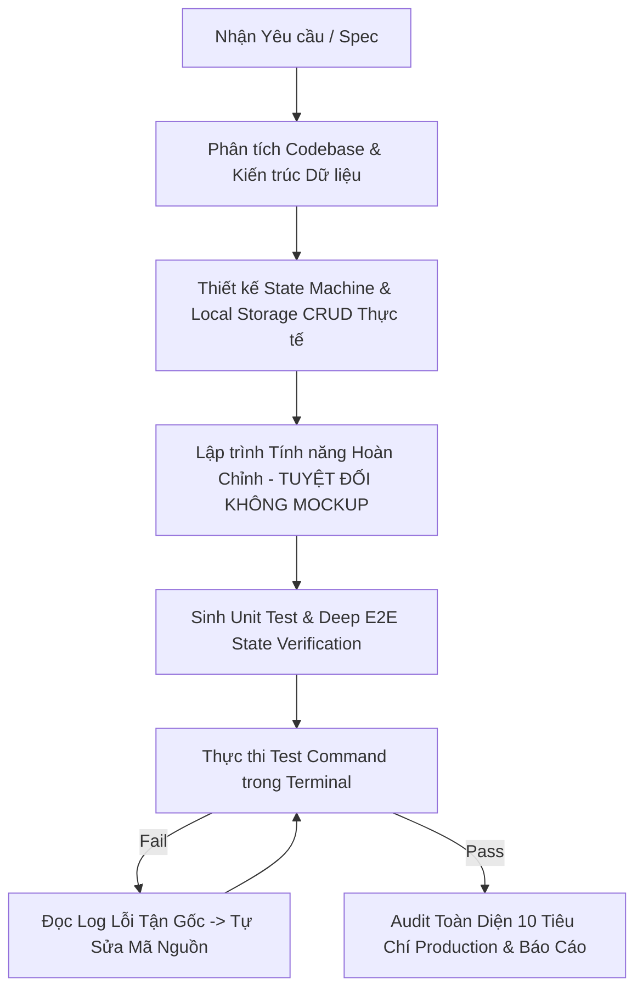

# Dev Executor: Autonomous Production-Grade Engineering Loop (`dev-executor`)

Skill này quy định quy trình kỹ thuật bắt buộc cho Developer Subagent khi nhận nhiệm vụ lập trình sản phẩm hoặc nâng cấp tính năng.

---

## 🛑 1. QUY TẮC CỐT LÕI: ZERO-MOCKUP MANDATE (CẤM DỮ LIỆU GIẢ)

Tuyệt đối cấm tạo ứng dụng kiểu "bề mặt demo" (surface mockup). Mọi màn hình và tính năng phải đáp ứng:

1. **100% Real Interactive State & CRUD:**
   - Mọi nút bấm, danh mục, bộ lọc, thẻ chi tiết đều phải có chức năng thực tế khi người dùng nhấp vào.
   - Cung cấp đầy đủ vòng đời CRUD (Thêm, Xem chi tiết, Sửa, Xóa) cho mọi đối tượng cốt lõi (Ví tiền, Giao dịch, Danh mục/Hũ, Ngân sách).
2. **Persistent Storage Engine:**
   - Dữ liệu PHẢI được lưu trữ vĩnh viễn (LocalStorage / IndexedDB / SQLite / MMKV).
   - Tắt ứng dụng, mở lại, hoặc đổi thiết bị KHÔNG được mất dữ liệu người dùng.
   - Hỗ trợ Xuất dữ liệu thật (Real CSV Export, JSON Backup) và Nhập file khôi phục thật.
3. **Dynamic Computation (Tính Toán Động):**
   - Biểu đồ, thanh tiến độ, bản đồ nhiệt (Heatmap), số dư khả dụng, và tỷ lệ phần trăm PHẢI được tính toán từ các giao dịch thực tế trong cơ sở dữ liệu, TUYỆT ĐỐI KHÔNG hardcode số liệu mẫu.
4. **Drill-Down Detail Views:**
   - Khi nhấp vào bất kỳ Hũ/Danh mục nào, hệ thống phải mở màn hình xem chi tiết lịch sử và phân tích của riêng Hũ đó.
5. **Real Settings & Security Controls:**
   - Cung cấp trang Cài đặt thực sự: Đổi đơn vị tiền tệ (VND, USD, EUR, JPY), Khóa mã PIN bảo mật, Quản lý danh sách Ví, Xóa sạch dữ liệu (Factory Reset) theo chuẩn GDPR/Google Play.

---

## 📋 2. TIÊU CHUẨN NGHIỆM THU KỸ THUẬT (PRODUCTION ACCEPTANCE GATES)

Mỗi lần bàn giao mã nguồn, Dev Agent phải tự kiểm tra và đáp ứng:

| Tiêu chuẩn | Yêu cầu bắt buộc |
| :--- | :--- |
| **Data Integrity** | Không xảy ra tình trạng NaN, null pointer, hoặc lệch số dư khi tính toán. Mọi phép cộng trừ tiền tệ phải qua Engine chuẩn hóa. |
| **Empty State** | Khi người dùng xóa hết giao dịch hoặc vừa cài mới, giao diện phải có Empty State hướng dẫn trực quan, không được vỡ layout. |
| **Input Validation** | Bàn phím số và máy tính mini phải chặn phép chia cho 0, chặn số âm không hợp lệ, chặn nhập chuỗi rác. |
| **Filter & Search** | Bộ lọc thời gian (Tuần này, Tháng này, Tất cả) và lọc theo Ví/Hũ phải phản hồi tức thì (< 50ms). |
| **Accessibility & Touch** | Nút bấm tối thiểu 44x44px, độ tương phản chuẩn WCAG 2.1 AA (≥ 4.5:1), hỗ trợ Dark Mode và Light Mode hoàn chỉnh. |

---

## 🔄 3. QUY TRÌNH THỰC THI 5 BƯỚC

1. **Context & Architecture Audit:** Rà soát kiến trúc State, mô hình dữ liệu (Schema), và luồng người dùng (User Journey).
2. **Data Layer Implementation:** Thiết lập tầng lưu trữ cục bộ, hàm khởi tạo dữ liệu mẫu lần đầu (Seed Data), và bộ xử lý sự kiện đồng bộ.
3. **Feature & UI Depth Engineering:** Xây dựng trọn vẹn các màn hình theo chuẩn `pro-uiux-design`, kết nối logic 2 chiều giữa View và Storage.
4. **Adversarial Verification Loop:** Chạy Unit Test và E2E Test tự động mô phỏng chuỗi tương tác phức tạp (Thêm -> Sửa -> Lọc -> Xóa -> Hoàn tác -> Đổi Theme -> Xuất File).
5. **Quality Handover:** Xuất báo cáo nghiệm thu kỹ thuật, cung cấp bằng chứng chạy thực tế kèm diff chi tiết.

---

## 📱 4. QUY CHUẨN KIỂM THỬ MOBILE E2E & MA TRẬN ĐA ĐỘ PHÂN GIẢI (MAESTRO & ADB MATRIX)

Đối với các dự án Mobile (React Native, Android Native), cấm tuyệt đối việc chỉ dựa vào Unit Test. Bắt buộc áp dụng bộ đôi **Maestro CLI** & **ADB Resolution Matrix**:

### 1. Kịch bản Maestro E2E Declarative Flow (`e2e/*.yaml`):
- Sử dụng Maestro CLI chạy trực tiếp trên file APK release/debug mà không cần sửa đổi mã nguồn.
- Bao phủ trọn vẹn luồng người dùng chính (User Journey):
  * Mở app -> Xác thực màn hình Home & Theme chuẩn.
  * Tự động chụp ảnh bằng chứng `takeScreenshot`.
  * Thực hiện chuỗi nhập liệu tương tác (máy tính, form, dialog).
  * Chuyển tab, kiểm tra cập nhật số liệu và hiển thị dữ liệu mới.
- Lưu ảnh chụp màn hình vào thư mục `e2e/screenshots/` phục vụ nghiệm thu.

### 2. Ma trận Kiểm thử Đa Độ Phân Giải (ADB Window Manager Matrix):
- Tự động thay đổi kích thước và mật độ điểm ảnh qua lệnh `adb shell wm` để kiểm tra độ thích ứng giao diện:
  * **HD Giá rẻ:** `720x1280` (DPI: 320).
  * **FHD+ Phổ thông (tỉ lệ 20:9):** `1080x2400` (DPI: 420).
  * **Flagship 2K (Tai thỏ / Đục lỗ):** `1440x3120` (DPI: 560).
  * **Tablet 10-inch:** `1600x2560` (DPI: 320).
- Sau khi kiểm thử, bắt buộc reset về mặc định: `adb shell wm size reset && adb shell wm density reset`.
- **Tiêu chí Pass:** Không bị tai thỏ đè nút/tiêu đề, nội dung luôn nằm trong Safe Area, các nút bấm chính (FAB / CTA) không bị bàn phím ảo hay thanh điều hướng che khuất.
