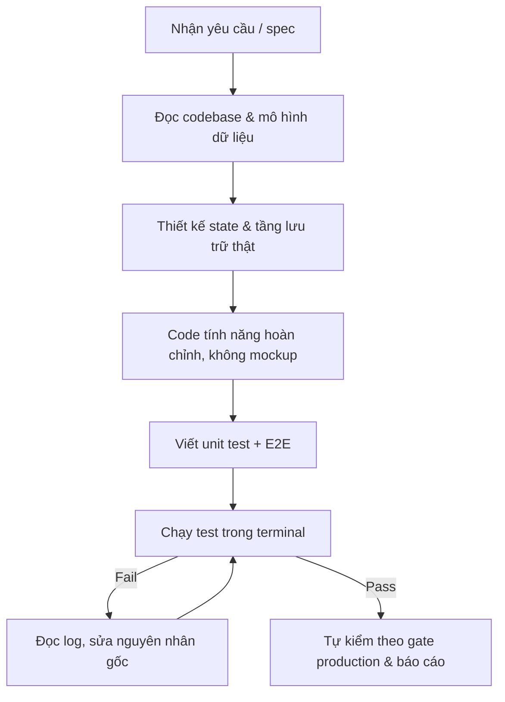

# Dev Executor: Autonomous Production-Grade Engineering Loop (`dev-executor`)

Quy trình kỹ thuật khi lập trình tính năng hoặc nâng cấp sản phẩm từ yêu cầu/spec đã rõ.

## Gotchas

- **Chưa chạy test thì chưa xong:** chỉ báo hoàn thành khi lệnh build/test đã chạy trong terminal và PASS (learned_patterns RULE-001, RULE-ENG-001). Không chạy được (thiếu thiết bị, thiếu secret) thì nói rõ phần nào chưa verify.
- **Không giấu lỗi** bằng try-catch rỗng hay fallback giả để test xanh (RULE-ENG-001).
- **Git:** mỗi task một nhánh `<prefix>/<ticket-id>-<mô-tả>` tách từ base mới nhất, commit theo Conventional Commits, không commit `.env`, `out/`, `dist/`, `.firebase/`, `node_modules/` (RULE-GIT-001). Đọc `references/git-standards.md` khi cần tạo nhánh, đặt tên nhánh hotfix/release, viết commit hoặc mở PR.
- **Secret:** keystore Android (`*.jks`), service-account JSON, `.env` production nằm ở `D:\SecureVault\<Project>\`; project trỏ tới bằng đường dẫn tuyệt đối trong file config đã gitignore (ví dụ `android/keystore.properties`). Build release lỗi vì thiếu key thì sửa đường dẫn đó, không copy secret vào repo.
- **Windows/PowerShell:** dùng cmdlet chuẩn, không dùng alias Unix trong PowerShell (reflexion_log REFLECT-2026-001); lọc log gradle/npm dài bằng `Select-String "BUILD|ERROR|FAIL"` trước khi đọc (RULE-PERF-001).
- **UI ID:** màn hình/nút/input chính có `id`/`data-testid` theo tiền tố `screen-*`, `btn-*`, `input-*`... (RULE-UI-002), vì Maestro/Playwright và analytics dựa vào các ID này.
- **Không cài package toàn cục** (`npm install -g`, `pip install` vào Python hệ thống) khi người dùng chưa đồng ý (RULE-SEC-001).
- **ADB:** sau khi đổi `wm size`/`wm density` để test, luôn reset (`adb shell wm size reset && adb shell wm density reset`), nếu không thiết bị/emulator của người dùng bị kẹt ở độ phân giải test.

## 1. Không mockup, không dữ liệu giả

Lý do: bản "bề mặt demo" trông xong nhưng vỡ ngay khi người dùng bấm thật, và phải làm lại từ tầng dữ liệu.

1. **Tương tác thật:** mọi nút, bộ lọc, thẻ chi tiết đều có hành vi khi bấm; đối tượng cốt lõi có đủ CRUD.
2. **Lưu trữ bền vững:** dữ liệu ghi vào storage thật của nền tảng (LocalStorage/IndexedDB/SQLite/MMKV/Firestore...), tắt mở lại app không mất. Có export/backup thì phải xuất file thật và nhập lại được.
3. **Số liệu tính động:** biểu đồ, tiến độ, số dư, phần trăm tính từ dữ liệu trong DB, không hardcode.
4. **Drill-down:** bấm vào một mục tổng hợp mở được màn chi tiết của riêng mục đó.
5. **Cài đặt thật:** các tùy chọn trong Settings phải có tác dụng; nếu có "xóa toàn bộ dữ liệu" thì xóa thật và có xác nhận.

Seed data lần đầu cài là được, miễn người dùng sửa/xóa được và không trộn với dữ liệu thật.

## 2. Gate nghiệm thu production

| Tiêu chuẩn | Yêu cầu |
| :--- | :--- |
| Toàn vẹn dữ liệu | Không NaN/null/lệch số dư; phép tính tiền qua một hàm chuẩn hóa (số nguyên đơn vị nhỏ nhất hoặc decimal), không float trần. |
| Empty state | Cài mới hoặc xóa hết dữ liệu vẫn có màn trống hướng dẫn, không vỡ layout. |
| Validate input | Chặn chia cho 0, số âm không hợp lệ, chuỗi rác. |
| Lọc & tìm kiếm | Phản hồi tức thì (< 50ms với dữ liệu cục bộ). |
| Accessibility | Vùng chạm ≥ 44×44px, tương phản ≥ 4.5:1 (WCAG 2.1 AA), Dark/Light mode đầy đủ. |

## 3. Quy trình 5 bước

1. **Đọc kiến trúc:** state, schema, user journey hiện có.
2. **Tầng dữ liệu:** storage, seed lần đầu, xử lý đồng bộ.
3. **Tính năng & UI:** dựng màn hình theo `pro-uiux-design`, nối hai chiều View ↔ Storage.
4. **Kiểm thử phản biện:** unit test + E2E mô phỏng chuỗi tương tác thật (thêm → sửa → lọc → xóa → hoàn tác → đổi theme → xuất file).
5. **Bàn giao:** báo cáo kèm lệnh test đã chạy, output tóm tắt và diff.

## 4. Mobile: Maestro E2E + ma trận độ phân giải ADB

Với React Native / Android native, unit test không đủ vì không bắt được lỗi layout và luồng thật trên thiết bị.

**Maestro (`e2e/*.yaml`)** — chạy trên APK debug/release, không sửa mã nguồn:
- Mở app → kiểm Home & theme → `takeScreenshot`.
- Nhập liệu qua form/dialog/máy tính, chuyển tab, kiểm số liệu cập nhật.
- Lưu ảnh vào `e2e/screenshots/` làm bằng chứng nghiệm thu.

**Ma trận `adb shell wm size` / `wm density`:**

| Thiết bị mô phỏng | Size | DPI |
| :--- | :--- | :--- |
| HD giá rẻ | 720x1280 | 320 |
| FHD+ 20:9 | 1080x2400 | 420 |
| Flagship 2K (tai thỏ) | 1440x3120 | 560 |
| Tablet 10" | 1600x2560 | 320 |

Pass khi: tai thỏ không đè nút/tiêu đề, nội dung nằm trong safe area, FAB/CTA không bị bàn phím ảo hay thanh điều hướng che. Xong thì reset (xem Gotchas).
