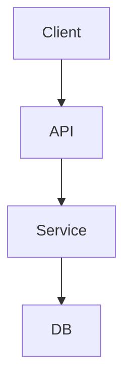

# Technical Design Spec: [Tên tính năng]

## 1. Codebase Audit (code đã đọc)
- `path/to/existing_file.ts`: [style, pattern, import convention ghi nhận được]
- Dependency manifest: [thư viện có sẵn sẽ tái sử dụng]

## 2. Kiến trúc & Data Flow

## 3. Data Schema & Migration
- Bảng/collection mới hoặc sửa (kèm type TypeScript/SQL).
- Kế hoạch migration và rollback.

## 4. State Machine (nếu có luồng trạng thái)
- Trạng thái, sự kiện chuyển, trạng thái lỗi.

## 5. API Contract
- Endpoint: `METHOD /api/v1/resource`
- Request schema · Response schema (khớp interface client SAU khi API client tự transform, ví dụ snake_case → camelCase).

## 6. Design Tokens & Localization Key Contract
| i18n Key | EN | VI | Dùng ở |
| :--- | :--- | :--- | :--- |
| `feature.title` | Feature Title | Tiêu đề tính năng | Title component |

## 7. Error Handling & Edge Cases
- Offline, timeout/retry, giá trị biên, danh sách rỗng, lỗi 4xx/5xx.
