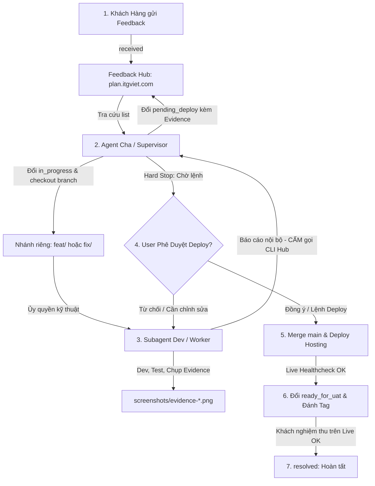

# [SKILL-INT-001] OneTech Workspace & ITG Feedback Hub Manager

Skill này chuyên trách quản lý tự động hóa toàn diện 2 hệ thống cốt lõi:
1. **OneTech Workspace** (`https://workspace.onetech.vn`): Hệ thống quản trị nội bộ 78+ dự án, Sprints, Tasks, Bugs, Comments và Workflow Statuses.
2. **ITG Customer Feedback Hub** (`https://plan.itgviet.com`): Cổng tiếp nhận phản hồi, báo lỗi realtime từ khách hàng cho từng dự án (`cafenhatsinh`, `issx`, `dtg`,...), lưu trữ trên Google Cloud Firestore (`itgviet-plan`).

---

## 🧭 Bản Đồ & Định Danh Dự Án (Project Mapping)

Khi người dùng hỏi về feedback hoặc task của dự án hiện tại, tự động ánh xạ thư mục làm việc sang Project Key:

| Thư mục Workspace | Mã Dự Án Feedback Hub (`projectKey`) | URL Cổng Khách Hàng | OneTech Project ID |
| :--- | :--- | :--- | :--- |
| `d:\Projects\NhatSinhCafe` | `cafenhatsinh` | `https://plan.itgviet.com/tickets?project=cafenhatsinh` | N/A (Internal/Cloud) |
| `d:\Projects\NhatSinhSite` | `nhatsinhsite` | `https://plan.itgviet.com/tickets?project=nhatsinhsite` | N/A (Brand Website) |
| `d:\Projects\insightScanX*` | `issx` | `https://plan.itgviet.com/tickets?project=issx` | `#82` (insightScanX_Product) |
| `d:\Projects\DTGenius*` | `dtg` | `https://plan.itgviet.com/tickets?project=dtg` | `#76` (DTGenius) |

---

## 🔄 Luồng Vòng Đời & Phân Cấp Trách Nhiệm (5-Stage Collaboration Lifecycle)



### 🎯 Quy Tắc Trạng Thái Ticket Chuẩn (Feedback Hub Statuses):
1. **`received` (Tiếp nhận):** Ticket mới được khách gửi lên cổng.
2. **`in_progress` (Đang xử lý):** Supervisor nhận vé, tạo branch riêng `feat/<ticket-id>` hoặc `fix/<ticket-id>` và giao việc cho Subagent.
3. **`pending_deploy` (Chờ deploy):** Subagent hoàn tất code, test, chụp evidence. Supervisor upload ảnh bằng chứng lên Hub và cập nhật trạng thái `pending_deploy`. **Dừng lại (Hard Stop) báo cáo User, CẤM tự ý deploy.**
4. **`ready_for_uat` (Chờ nghiệm thu UAT):** CHỈ CẬP NHẬT KHI ĐÃ DEPLOY LÊN LIVE THÀNH CÔNG (sau khi User phê duyệt). Khách hàng sẽ vào domain live thật (`cafe.nhatsinh.com.vn`) để kiểm tra.
5. **`resolved` (Hoàn tất):** Khách hàng/Quản lý nghiệm thu hài lòng và đóng vé.

---

### 🛡️ Nguyên Tắc Phân Quyền Giao Tiếp (Anti-Spam Boundary):
- **Subagent (Dev/Worker):** CẤM TUYỆT ĐỐI gọi các lệnh `cli.py feedback ...` hoặc `cli.py comment/status`. Subagent chỉ làm việc trong local codebase, xuất ảnh vào thư mục `screenshots/` và gửi message nội bộ cho Supervisor.
- **Supervisor (Parent Agent):** Là ĐẦU MỐI DUY NHẤT được phép tương tác với Feedback Hub:
  - 1 lần khi bắt đầu: `in_progress`
  - 1 lần khi xong code/evidence: `pending_deploy` kèm ảnh evidence
  - 1 lần sau khi deploy live thành công: `ready_for_uat` hướng dẫn khách test


---

## 🛠️ Bộ Công Cụ & Thư Viện (Scripts)

📁 **Thư mục thực thi (Scripts Execution Hub):**
- **Đường dẫn từ workspace root:** `skills/onetech-workspace-manager/scripts/`
- **Đường dẫn nội bộ skill:** `scripts/`
*(Tương thích với mọi Agent: Antigravity, Kiro, Claude, Cursor... Tự động định vị dữ liệu và profile tương đối)*

1. **`feedback_client.py` (`FeedbackHubClient`):**
   * Tương tác trực tiếp với Google Cloud Firestore của Feedback Hub (`itgviet-plan`) qua REST API.
   * **Cơ chế xác thực:** Tự động lấy và làm mới OAuth access token qua Firebase CLI (`~/.config/configstore/firebase-tools.json`), không cần đăng nhập lại.
   * `get_projects()`: Danh sách các dự án trên Hub.
   * `get_tickets(project_key)`: Lấy danh sách vé phản hồi (lọc theo dự án).
   * `get_ticket(ticket_id)`: Xem chi tiết vé, metadata thiết bị khách hàng, ảnh đính kèm và trao đổi (comments).
   * `update_status(ticket_id, status, comment)`: Cập nhật trạng thái (`received`, `in_progress`, `ready_for_uat`, `resolved`).
   * `add_comment(ticket_id, content)`: Gửi phản hồi vào luồng chat của vé cho khách hàng.
   * `link_onetech_task(ticket_id, onetech_task_id, project_id)`: Liên kết mã task OneTech vào vé phản hồi.

2. **`onetech_client.py` (`OneTechClient`):**
   * Điều khiển Chromium headless với persistent profile (tự động nhận diện từ `data/playwright_profile` hoặc profile người dùng).
   * Thao tác trên `https://workspace.onetech.vn`: Sprints, Projects, Tasks, Comments, Upload ảnh CDN.

3. **`cli.py`:** Giao diện dòng lệnh hợp nhất hỗ trợ cả OneTech và Feedback Hub.

---

## 💻 Hướng Dẫn Sử Dụng Nhanh (CLI Commands)

> **Ghi chú đường dẫn CLI**: Các lệnh dưới đây dùng đường dẫn tương đối từ workspace root: `skills/onetech-workspace-manager/scripts/cli.py` (hoặc `scripts/cli.py` nếu đang ở trong thư mục skill).

### 🌟 1. Tra cứu & Quản lý trên ITG Feedback Hub (`plan.itgviet.com`)

#### Xem danh sách ticket mới của dự án:
```powershell
# Liệt kê vé phản hồi của dự án Nhật Sinh Cafe:
python skills/onetech-workspace-manager/scripts/cli.py feedback list --project cafenhatsinh

# Liệt kê vé phản hồi của dự án ISSX:
python skills/onetech-workspace-manager/scripts/cli.py feedback list --project issx
```

#### Xem chi tiết 1 ticket (kèm ảnh, mô tả, cấu hình máy KH):
```powershell
python skills/onetech-workspace-manager/scripts/cli.py feedback get --ticket CAFENHATSINH-584
```

#### Cập nhật trạng thái ticket và phản hồi cho khách:
```powershell
# Cập nhật sang ĐANG XỬ LÝ (in_progress):
python skills/onetech-workspace-manager/scripts/cli.py feedback status `
  --ticket CAFENHATSINH-584 `
  --status in_progress `
  --message "Đội ngũ kỹ thuật đã tiếp nhận và đang tiến hành tối ưu giao diện."

# Cập nhật sang SẴN SÀNG KIỂM THỬ (ready_for_uat):
python skills/onetech-workspace-manager/scripts/cli.py feedback status `
  --ticket CAFENHATSINH-584 `
  --status ready_for_uat `
  --message "Đã tối ưu xong layout màn hình đặt món. Mời quán kiểm tra lại trên máy tính tiền."
```

#### Gửi bình luận riêng vào ticket:
```powershell
python skills/onetech-workspace-manager/scripts/cli.py feedback comment `
  --ticket CAFENHATSINH-584 `
  --message "Bản vá đã được triển khai lên máy chủ live."
```

#### Liên kết Ticket với OneTech Task:
```powershell
python skills/onetech-workspace-manager/scripts/cli.py feedback link `
  --ticket ISSX-101 `
  --task 8303 `
  --onetech-project 82
```

---

### 🏢 2. Thao tác trên OneTech Workspace (`workspace.onetech.vn`)

> [!IMPORTANT]
> **QUY TẮC CẤM TẠO SCRIPT RÁC:**
> Tuyệt đối **KHÔNG** tạo các file script Python tạm thời (như `get_task_*.py`, `get_open_tasks.py`, `get_project_*.py`) khi tra cứu task hoặc bình luận.
> **LUÔN SỬ DỤNG** bộ lệnh CLI tối ưu sẵn (`cli.py list`, `cli.py task`, `cli.py comments`). Các lệnh này ưu tiên đọc từ cache local (`tasks_store.json`) với tốc độ **0.05 giây**, không làm nặng máy và không mở trình duyệt thừa.

#### Xem danh sách dự án:
```powershell
python D:\ITGVietAssistant\skills\onetech-workspace-manager\scripts\cli.py projects
```

#### Tra cứu danh sách Task (Siêu tốc từ Cache):
```powershell
# Xem task đang mở (chưa Done) của tôi trong dự án DTGenius (#76):
python D:\ITGVietAssistant\skills\onetech-workspace-manager\scripts\cli.py list --project 76 --mine --status open

# Tìm kiếm task theo từ khóa:
python D:\ITGVietAssistant\skills\onetech-workspace-manager\scripts\cli.py list --project 76 --search "inventory"

# Bắt buộc lấy dữ liệu live trực tiếp qua browser (bỏ qua cache):
python D:\ITGVietAssistant\skills\onetech-workspace-manager\scripts\cli.py list --project 82 --live
```

#### Xem chi tiết một Task cụ thể (0.05 giây):
```powershell
# Xem chi tiết task 7972 (tiêu đề, trạng thái, sprint, assignee, mô tả, AC):
python D:\ITGVietAssistant\skills\onetech-workspace-manager\scripts\cli.py task 7972

# Xem chi tiết kèm toàn bộ bình luận:
python D:\ITGVietAssistant\skills\onetech-workspace-manager\scripts\cli.py task 7972 --comments
```

#### Quản lý Bình luận Task (Tự động chuẩn hóa Markdown, chống lộ thẻ HTML):
```powershell
# Xem danh sách bình luận của task:
python D:\ITGVietAssistant\skills\onetech-workspace-manager\scripts\cli.py comments 8370

# Đăng bình luận mới (tự động làm sạch định dạng, hỗ trợ xuống dòng \n):
python D:\ITGVietAssistant\skills\onetech-workspace-manager\scripts\cli.py comments 8370 --add "[Update]\n• Hoàn thành kiểm thử\n• Đã commit code"

# Xóa một bình luận theo Comment ID:
python D:\ITGVietAssistant\skills\onetech-workspace-manager\scripts\cli.py comments 8370 --delete 4990
```

#### Tạo Task / Bug mới:
```powershell
python D:\ITGVietAssistant\skills\onetech-workspace-manager\scripts\cli.py create `
  --project 82 `
  --sprint 79 `
  --type bug `
  --priority high `
  --severity major `
  --assignee dinhpl `
  --title "[CMS] Issue popup is overlapped by panel" `
  --description "Mô tả chi tiết lỗi..."
```

#### Cập nhật trạng thái Task:
```powershell
python skills/onetech-workspace-manager/scripts/cli.py update 8086 --status done
```

#### Quản lý & Tự động Log Timesheet:
```powershell
# 1. Kiểm tra tiến độ log giờ hôm nay (mục tiêu 8.0h):
python skills/onetech-workspace-manager/scripts/cli.py timesheet today

# 2. Thống kê toàn bộ thời gian làm việc trong tuần (Thứ 2 -> Chủ nhật):
python skills/onetech-workspace-manager/scripts/cli.py timesheet week

# 3. Xem lịch sử timesheet của 1 task:
python skills/onetech-workspace-manager/scripts/cli.py timesheet list --task 8274

# 4. Tự động log giờ vào task:
python skills/onetech-workspace-manager/scripts/cli.py timesheet log `
  --task 8274 `
  --hours 2.5 `
  --type development `
  --desc "Nghiên cứu và triển khai thuật toán lọc loại bỏ con người khỏi point cloud"

# 5. Xóa một bản ghi timesheet:
python skills/onetech-workspace-manager/scripts/cli.py timesheet delete --entry-id 1234
```

---

## 📌 Quy Chuẩn Nghiêm Ngặt Khi Đăng Task & Trao Đổi

1. **Quy chuẩn ngôn ngữ (Language Policy):**
   - **Tiêu đề (Title):** Bắt buộc 100% viết bằng **Tiếng Anh (English)** chuẩn kỹ thuật theo cú pháp: `[Module/Scope] Clear descriptive title in English` (ví dụ: `[Processing Server] Point cloud turns black after auto-processing in BIM scan mode`, `[APP] Manual AprilTag Placement Guide`, `[CMS] Issue popup is overlapped by panel`).
   - **Nội dung mô tả (Description) & Thảo luận (Comments):** Viết bằng **Tiếng Việt chuyên nghiệp, ngắn gọn**, cấu trúc 3 phần rõ ràng:
     - `### 1. Hiện trạng & Mô tả lỗi:`
     - `### 2. Tác động / Nguyên nhân:`
     - `### 3. Đề xuất giải pháp khắc phục:`
2. **Định dạng xuống dòng & Trình bày (Formatting Quality):**
   - Tuyệt đối không để dính chuỗi hoặc in nguyên văn ký tự `\n` thô. Luôn ngắt dòng thực sự, có gạch đầu dòng bullet points rõ ràng.
3. **Không tự bịa nội dung (Zero Hallucination):** Chỉ trích xuất đúng mô tả, ảnh chụp và dữ liệu môi trường thực tế từ ticket khách gửi hoặc phản ánh của người dùng.
4. **Phản hồi khách hàng (Comments trên Feedback Hub):** Dùng tiếng Việt lịch sự, rõ ràng, nêu bật giải pháp đã xử lý và hướng dẫn khách kiểm tra lại (UAT).
