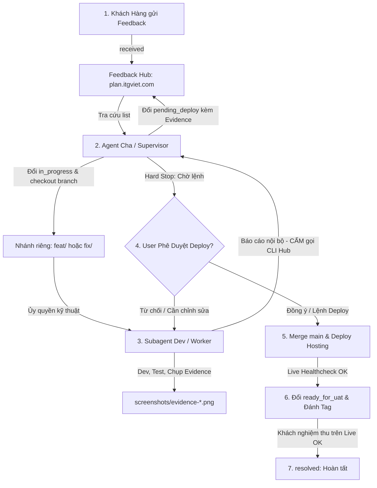

# [SKILL-INT-001] OneTech Workspace & ITG Feedback Hub Manager

Skill này chuyên trách quản lý tự động hóa toàn diện 2 hệ thống cốt lõi:
1. **OneTech Workspace** (`https://workspace.onetech.vn`): Hệ thống quản trị nội bộ 78+ dự án, Sprints, Tasks, Bugs, Comments và Workflow Statuses.
2. **ITG Customer Feedback Hub** (`https://plan.itgviet.com`): Cổng tiếp nhận phản hồi, báo lỗi realtime từ khách hàng cho từng dự án (`cafenhatsinh`, `issx`, `dtg`,...), lưu trữ trên Google Cloud Firestore (`itgviet-plan`).

## ⚠️ Gotchas

- **Lệnh ghi là hành động ra bên ngoài — hỏi người dùng trước khi chạy.** `feedback status|comment|link`, `comment`, `comments --add|--delete`, `create`, `update`, `upload`, `timesheet log|delete` đều ghi lên hệ thống thật: khách hàng thấy ngay comment/trạng thái trên Feedback Hub, đồng đội nhận thông báo OneTech. Đọc lại nội dung, nêu rõ lệnh sẽ chạy và chờ xác nhận (Claude Code: AskUserQuestion · Antigravity: ask_question). Lệnh đọc (`projects`, `list`, `task`, `comments <id>` không kèm cờ, `feedback list|get|projects`, `timesheet today|week|list`, `history`) chạy được ngay.
- **`list`/`task` đọc cache `$ITGVIET_HOME/data/tasks_store.json`, không phải dữ liệu live.** Khi người dùng vừa đổi gì trên web hoặc cần số liệu chính xác, thêm `--live` hoặc chạy `sync --project <id>` trước. `sync` mặc định project 82 nếu không truyền `--project`.
- **Mặc định ngầm là project 82 (insightScanX).** `sync`, `create` và `feedback link --onetech-project` đều default 82 — luôn truyền `--project`/`--onetech-project` khi làm với dự án khác (DTGenius là 76), nếu không task sẽ rơi nhầm dự án.
- **`list` chỉ hiển thị 15 task mặc định** (đổi từ 50 ở commit `d2f5895`). Khi trả lời "còn bao nhiêu task" hãy đọc dòng tổng `Tìm thấy N tasks` hoặc dùng `--limit`.
- **Trạng thái OneTech map sang workflowStatusId cố định**: `todo`→405, `in_progress`→406, `implementing`→407, `review`→408, `done`→409, `cancel`→405 + `bugStatus=closed`. Dùng đúng tên trong `update --status`, không tự gửi ID.
- **`create --assignee` nhận User ID (UUID)**; alias được hiểu sẵn chỉ có `dinhpl`/`dinh` và `vietnt`/`viet`/`me`. Người khác cần UUID thật — không đoán.
- **Feedback Hub phân trang.** `feedback list` đọc `pageSize=300` và theo `nextPageToken` (fix `34cfa20` + bản sửa đang làm); nếu tự gọi API thì phải theo token, không sẽ mất ticket cũ.
- **Timesheet API dùng tham số `start`/`end`** (không phải `startDate`/`endDate` — fix `34cfa20`). OneTech trả HTTP 429 khi gọi dồn dập: `history` mất vài phút là bình thường, đừng chạy song song nhiều lệnh.
- **Không viết script Python tạm** (`get_task_*.py`…) để tra cứu: CLI đã đọc cache trong ~0.05 giây và không mở trình duyệt; script tạm vừa chậm (mở Chromium) vừa để lại file rác trong repo.

---

## 🧭 Bản Đồ & Định Danh Dự Án (Project Mapping)

Khi người dùng hỏi về feedback hoặc task của dự án hiện tại, tự động ánh xạ thư mục làm việc sang Project Key:

| Thư mục Workspace | Mã Dự Án Feedback Hub (`projectKey`) | URL Cổng Khách Hàng | OneTech Project ID |
| :--- | :--- | :--- | :--- |
| `d:\Projects\NhatSinhCafe` | `cafenhatsinh` | `https://plan.itgviet.com/tickets?project=cafenhatsinh` | N/A (Internal/Cloud) |
| `d:\Projects\NhatSinhSite` | `nhatsinhsite` | `https://plan.itgviet.com/tickets?project=nhatsinhsite` | N/A (Brand Website) |
| `d:\Projects\insightScanX*` | `issx` | `https://plan.itgviet.com/tickets?project=issx` | `#82` (insightScanX_Product) |
| `d:\Projects\DTGenius*` | `dtg` | `https://plan.itgviet.com/tickets?project=dtg` | `#76` (DTGenius) |

---

## 🔄 Luồng Vòng Đời & Phân Cấp Trách Nhiệm (5-Stage Collaboration Lifecycle)



### 🎯 Quy Tắc Trạng Thái Ticket Chuẩn (Feedback Hub Statuses):
1. **`received` (Tiếp nhận):** Ticket mới được khách gửi lên cổng.
2. **`in_progress` (Đang xử lý):** Supervisor nhận vé, tạo branch riêng `feat/<ticket-id>` hoặc `fix/<ticket-id>` và giao việc cho Subagent.
3. **`pending_deploy` (Chờ deploy):** Subagent hoàn tất code, test, chụp evidence. Supervisor upload ảnh bằng chứng lên Hub và cập nhật trạng thái `pending_deploy`. Sau đó dừng lại báo cáo người dùng và chờ lệnh deploy — vì deploy production thuộc phạm vi `production-safety-guardrail`.
4. **`ready_for_uat` (Chờ nghiệm thu UAT):** Chỉ đặt sau khi đã deploy live thành công (người dùng đã duyệt) — vì khách sẽ kiểm tra ngay trên bản live, đặt sớm khiến khách test bản cũ. Khách hàng sẽ vào domain live thật (`cafe.nhatsinh.com.vn`) để kiểm tra.
5. **`resolved` (Hoàn tất):** Khách hàng/Quản lý nghiệm thu hài lòng và đóng vé.
6. **`rejected` (Từ chối):** Không xử lý (trùng, ngoài phạm vi). Luôn kèm `--message` giải thích cho khách.

---

### 🛡️ Nguyên Tắc Phân Quyền Giao Tiếp (Anti-Spam Boundary):
- **Subagent (Dev/Worker):** không gọi `cli.py feedback ...`, `cli.py comment` hay đổi trạng thái — vì mỗi lệnh đó gửi thẳng tới khách/đồng đội, nhiều subagent cùng gọi sẽ thành spam và trạng thái chồng chéo. Subagent chỉ làm trong local codebase, xuất ảnh vào `screenshots/` và báo cáo cho Supervisor.
- **Supervisor (Parent Agent):** là đầu mối duy nhất tương tác với Feedback Hub, tối đa 3 lần mỗi ticket (mỗi lần đều cần người dùng xác nhận nội dung):
  - 1 lần khi bắt đầu: `in_progress`
  - 1 lần khi xong code/evidence: `pending_deploy` kèm ảnh evidence
  - 1 lần sau khi deploy live thành công: `ready_for_uat` hướng dẫn khách test


---

## 🛠️ Bộ Công Cụ & Thư Viện (Scripts)

📁 Mọi đường dẫn script trong skill này tính **từ thư mục của skill** (ví dụ `scripts/cli.py`), dùng chung cho Claude, Antigravity, Kiro… Script tự tìm `$ITGVIET_HOME` (thư mục cha của `skills/`) để đọc/ghi `data/` và profile Playwright. Xem đầy đủ tham số: `python scripts/cli.py <lệnh> --help`.

1. **`feedback_client.py` (`FeedbackHubClient`):**
   * Tương tác trực tiếp với Google Cloud Firestore của Feedback Hub (`itgviet-plan`) qua REST API.
   * **Cơ chế xác thực:** Tự động lấy và làm mới OAuth access token qua Firebase CLI (`~/.config/configstore/firebase-tools.json`), không cần đăng nhập lại.
   * `get_projects()`: Danh sách các dự án trên Hub.
   * `get_tickets(project_key)`: Lấy danh sách vé phản hồi (lọc theo dự án).
   * `get_ticket(ticket_id)`: Xem chi tiết vé, metadata thiết bị khách hàng, ảnh đính kèm và trao đổi (comments).
   * `update_status(ticket_id, status, comment)`: Cập nhật trạng thái (`received`, `in_progress`, `ready_for_uat`, `resolved`).
   * `add_comment(ticket_id, content)`: Gửi phản hồi vào luồng chat của vé cho khách hàng.
   * `link_onetech_task(ticket_id, onetech_task_id, project_id)`: Liên kết mã task OneTech vào vé phản hồi.

2. **`onetech_client.py` (`OneTechClient`):**
   * Điều khiển Chromium headless với persistent profile (tự động nhận diện từ `data/playwright_profile` hoặc profile người dùng).
   * Thao tác trên `https://workspace.onetech.vn`: Sprints, Projects, Tasks, Comments, Upload ảnh CDN.

3. **`cli.py`:** Giao diện dòng lệnh hợp nhất hỗ trợ cả OneTech và Feedback Hub.

4. **`history_export.py`:** Lệnh `cli.py history` (chỉ đọc) xuất lịch sử công việc ra `data/work_history/` (tasks, timesheet, tickets, git commits, status snapshots + `README.md` mô tả schema) làm nguồn cho dashboard.

---

## 💻 Hướng Dẫn Sử Dụng Nhanh (CLI Commands)

> **Ghi chú**: Đường dẫn tính từ thư mục skill. Lệnh đánh dấu ✍️ là lệnh ghi ra hệ thống thật — xác nhận với người dùng trước khi chạy (xem Gotchas).

### 🌟 1. Tra cứu & Quản lý trên ITG Feedback Hub (`plan.itgviet.com`)

#### Xem danh sách ticket mới của dự án:
```powershell
# Liệt kê vé phản hồi của dự án Nhật Sinh Cafe:
python scripts/cli.py feedback list --project cafenhatsinh

# Liệt kê vé phản hồi của dự án ISSX:
python scripts/cli.py feedback list --project issx
```

#### Xem chi tiết 1 ticket (kèm ảnh, mô tả, cấu hình máy KH):
```powershell
python scripts/cli.py feedback get --ticket CAFENHATSINH-584
```

#### ✍️ Cập nhật trạng thái ticket và phản hồi cho khách:
```powershell
# Cập nhật sang ĐANG XỬ LÝ (in_progress):
python scripts/cli.py feedback status `
  --ticket CAFENHATSINH-584 `
  --status in_progress `
  --message "Đội ngũ kỹ thuật đã tiếp nhận và đang tiến hành tối ưu giao diện."

# Cập nhật sang SẴN SÀNG KIỂM THỬ (ready_for_uat):
python scripts/cli.py feedback status `
  --ticket CAFENHATSINH-584 `
  --status ready_for_uat `
  --message "Đã tối ưu xong layout màn hình đặt món. Mời quán kiểm tra lại trên máy tính tiền."
```

#### ✍️ Gửi bình luận vào ticket (khách đọc được):
```powershell
python scripts/cli.py feedback comment `
  --ticket CAFENHATSINH-584 `
  --message "Bản vá đã được triển khai lên máy chủ live."
```

#### ✍️ Liên kết Ticket với OneTech Task:
```powershell
python scripts/cli.py feedback link `
  --ticket ISSX-101 `
  --task 8303 `
  --onetech-project 82
```

---

### 🏢 2. Thao tác trên OneTech Workspace (`workspace.onetech.vn`)

> Tra cứu bằng `list`, `task`, `comments` (đọc cache) thay vì viết script tạm — xem Gotchas.

#### Xem danh sách dự án:
```powershell
python scripts/cli.py projects
```

#### Tra cứu danh sách Task (Siêu tốc từ Cache):
```powershell
# Xem task đang mở (chưa Done) của tôi trong dự án DTGenius (#76):
python scripts/cli.py list --project 76 --mine --status open

# Tìm kiếm task theo từ khóa:
python scripts/cli.py list --project 76 --search "inventory"

# Bắt buộc lấy dữ liệu live trực tiếp qua browser (bỏ qua cache):
python scripts/cli.py list --project 82 --live
```

#### Xem chi tiết một Task cụ thể (0.05 giây):
```powershell
# Xem chi tiết task 7972 (tiêu đề, trạng thái, sprint, assignee, mô tả, AC):
python scripts/cli.py task 7972

# Xem chi tiết kèm toàn bộ bình luận:
python scripts/cli.py task 7972 --comments
```

#### Quản lý Bình luận Task (Tự động chuẩn hóa Markdown, chống lộ thẻ HTML):
```powershell
# Xem danh sách bình luận của task:
python scripts/cli.py comments 8370

# ✍️ Đăng bình luận mới (tự động làm sạch định dạng, hỗ trợ xuống dòng \n; --image để đính ảnh):
python scripts/cli.py comments 8370 --add "[Update]\n• Hoàn thành kiểm thử\n• Đã commit code"

# ✍️ Xóa một bình luận theo Comment ID (không khôi phục được):
python scripts/cli.py comments 8370 --delete 4990
```

#### ✍️ Tạo Task / Bug mới:
```powershell
python scripts/cli.py create `
  --project 82 `
  --sprint 79 `
  --type bug `
  --priority high `
  --severity major `
  --assignee dinhpl `
  --title "[CMS] Issue popup is overlapped by panel" `
  --description "Mô tả chi tiết lỗi..."
```

#### ✍️ Cập nhật trạng thái Task:
```powershell
python scripts/cli.py update 8086 --status done
# Trạng thái hợp lệ: todo | in_progress | implementing | review | done | cancel. Đổi sprint/ưu tiên/tiêu đề: --sprint, --priority, --title.
```

#### ✍️ Upload ảnh / bình luận nhanh kèm ảnh:
```powershell
python scripts/cli.py upload screenshots/evidence-1.png          # trả về URL CDN
python scripts/cli.py comment 8370 --message "Đã fix" --image screenshots/evidence-1.png
```

#### Quản lý & Tự động Log Timesheet:
```powershell
# 1. Kiểm tra tiến độ log giờ hôm nay (mục tiêu 8.0h):
python scripts/cli.py timesheet today

# 2. Thống kê toàn bộ thời gian làm việc trong tuần (Thứ 2 -> Chủ nhật):
python scripts/cli.py timesheet week

# 3. Xem lịch sử timesheet của 1 task:
python scripts/cli.py timesheet list --task 8274

# 4. ✍️ Log giờ vào task (--date YYYY-MM-DD để log ngày khác):
python scripts/cli.py timesheet log `
  --task 8274 `
  --hours 2.5 `
  --type development `
  --desc "Nghiên cứu và triển khai thuật toán lọc loại bỏ con người khỏi point cloud"

# 5. ✍️ Xóa một bản ghi timesheet:
python scripts/cli.py timesheet delete --entry-id 1234
```

#### Xuất lịch sử công việc cho dashboard (chỉ đọc, chạy hằng ngày để có status snapshot):
```powershell
# Xuất tất cả nguồn ra data/work_history (OneTech mất vài phút vì bị giới hạn tần suất HTTP 429):
python scripts/cli.py history

# Chỉ một số nguồn:
python scripts/cli.py history --sources git,tickets
```

---

## 📌 Quy Chuẩn Khi Đăng Task & Trao Đổi

1. **Quy chuẩn ngôn ngữ (Language Policy):**
   - **Tiêu đề (Title):** viết bằng **Tiếng Anh** (team đa quốc tịch đọc board) chuẩn kỹ thuật theo cú pháp: `[Module/Scope] Clear descriptive title in English` (ví dụ: `[Processing Server] Point cloud turns black after auto-processing in BIM scan mode`, `[APP] Manual AprilTag Placement Guide`, `[CMS] Issue popup is overlapped by panel`).
   - **Nội dung mô tả (Description) & Thảo luận (Comments):** Viết bằng **Tiếng Việt chuyên nghiệp, ngắn gọn**, cấu trúc 3 phần rõ ràng:
     - `### 1. Hiện trạng & Mô tả lỗi:`
     - `### 2. Tác động / Nguyên nhân:`
     - `### 3. Đề xuất giải pháp khắc phục:`
2. **Định dạng xuống dòng & Trình bày (Formatting Quality):**
   - Không để lộ ký tự `\n` thô (OneTech hiển thị nguyên văn, khó đọc). Luôn ngắt dòng thực sự, có gạch đầu dòng bullet points rõ ràng.
3. **Không tự bịa nội dung (Zero Hallucination):** Chỉ trích xuất đúng mô tả, ảnh chụp và dữ liệu môi trường thực tế từ ticket khách gửi hoặc phản ánh của người dùng.
4. **Phản hồi khách hàng (Comments trên Feedback Hub):** Dùng tiếng Việt lịch sự, rõ ràng, nêu bật giải pháp đã xử lý và hướng dẫn khách kiểm tra lại (UAT).
