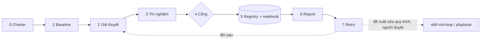

# rnd-loop — Quy trình R&D chung, tự cải thiện

Mỗi task R&D có cách làm và cách report riêng, nhưng **đi qua cùng một vòng**. Phần riêng của task nằm
trong **một file charter**; phần chung (vòng lặp, cổng, lịch sử, dashboard) nằm trong skill này.

## Vị trí (dùng chung Gemini + Claude)

| Thứ | Đường dẫn |
|---|---|
| Script | `<skill-dir>/scripts/rnd.py` — Claude: `~/.claude/skills/rnd-loop/scripts/rnd.py`, Gemini: `~/.gemini/config/skills/rnd-loop/scripts/rnd.py`, gốc: `D:\ITGVietAssistant\skills\rnd-loop\scripts\rnd.py` |
| Playbook chung mọi dự án | `memory/rnd_playbook.md` — Claude: `~/.claude/shared-memory/rnd_playbook.md`, Gemini: `~/.gemini/config/memory/rnd_playbook.md` |
| Dữ liệu task (trong repo dự án, git-tracked) | `rnd/<task>/charter.toml`, `registry.jsonl`, `notebook.md`, `runs/`, `reports/`; `rnd/dashboard.html` |

Script chỉ dùng stdlib, Python ≥ 3.11. Chạy từ gốc repo dự án (hoặc bất kỳ thư mục con nào).

## Bước 0 — Đọc trước khi làm

1. Đọc `rnd_playbook.md` (bài học chung). Áp dụng mục nào liên quan và nói rõ đã áp dụng mục nào.
2. Nếu task đã có: `rnd.py status <task>` và đọc `notebook.md` — **không làm lại giả thuyết đã bị bác** trừ khi có lý do mới.
3. Đọc luật của dự án (AGENTS.md / CLAUDE.md / GEMINI.md). Luật dự án thắng skill này.

## Bước 1 — Charter (một lần mỗi task)

`rnd.py init <task>` rồi điền `rnd/<task>/charter.toml` **cùng người dùng**:
- `task.question`: câu hỏi trả lời được bằng số đo. "Làm cho tốt hơn" không phải câu hỏi.
- `run.command`: lệnh đánh giá, ghi `metrics_file` dạng `{"cases": {case: {metric: số}}, "aggregate": {...}}`.
  Nếu dự án chưa có evaluator, **viết evaluator trước** — đây là việc quan trọng nhất của cả task.
- `metrics` (goal max/min, tolerance = ngưỡng nhiễu) và `constraints` (ngưỡng tuyệt đối, có `why`).
- `report.sections / evidence / audience`: cách report riêng của task này.
- `scope` / `off_limits`.

Chất lượng benchmark quyết định mọi thứ sau. Kiểm tra: case có độc lập không (không so dữ liệu với chính nó)?
có ground truth không? nếu chưa có thì ghi rõ trong notebook là **baseline tương đối, không phải độ chính xác thật**.

## Bước 2 — Baseline

`rnd.py run <task> --kind baseline -H "trạng thái hiện tại"` — trên code đã commit nếu có thể (registry ghi `git.dirty`).
Baseline có `baseline_with_failures` nghĩa là trạng thái hiện tại vi phạm constraint: báo người dùng, đó chính là việc cần R&D.

## Bước 3 — Giả thuyết

Thêm vào `[[hypotheses]]` trong charter: một câu, có cơ chế ("vì X nên đổi Y sẽ làm Z tăng"), và case kỳ vọng thay đổi.
Ưu tiên giả thuyết nhắm vào case đang fail. Mỗi thí nghiệm **một thay đổi** để quy được nguyên nhân.

## Bước 4 — Thí nghiệm + cổng

1. Làm trên nhánh `exp/<task>-<slug>` (hoặc worktree riêng), không trên main.
2. Sửa code / tham số trong `scope`.
3. Chạy test của dự án (thay đổi không được làm vỡ test).
4. `rnd.py run <task> -H "<giả thuyết>" --change "<commit/flag>"`.
5. Đọc verdict:
   - `accepted`: constraints giữ, không case nào hồi quy quá tolerance, ≥ 1 cải thiện.
   - `neutral`: không xấu đi, không tốt lên — **không merge** chỉ vì "không hại"; ghi bài học.
   - `rejected`: ghi rõ lý do vào notebook (`#lesson`), cập nhật status giả thuyết.
6. Lặp tối đa số vòng người dùng cho phép (mặc định 3) rồi dừng và report.

**Không bao giờ**: sửa evaluator / charter / constraints trong cùng thí nghiệm để làm verdict đẹp hơn
(đổi thước đo là một quyết định riêng, ghi `#decision`, chạy lại baseline); tự merge; tự `promote`.
Sau khi người dùng merge một run `accepted`: `rnd.py promote <task> <run-id>`.

## Bước 5 — Ghi chép

- Registry tự ghi khi `run`. Notebook ghi bằng `rnd.py note <task> "..." --tag lesson|decision|data|bug|idea`.
- Mỗi kết luận trong notebook phải trỏ về run-id làm bằng chứng.
- `rnd.py dashboard` sau mỗi đợt; mở `rnd/dashboard.html` (hoặc publish thành artifact nếu người dùng muốn chia sẻ).

## Bước 6 — Report

Theo `charter.report.sections` (mặc định dùng `templates/report.md`), lưu `rnd/<task>/reports/<YYYY-MM-DD>-<slug>.md`.
Luật chung cho mọi report, bất kể task:
- Câu đầu trả lời câu hỏi của charter, kèm verdict và mức tin cậy.
- Số nào cũng có run-id; so với baseline nào.
- Có mục **"số liệu KHÔNG chứng minh điều gì"**.
- Bằng chứng theo `charter.report.evidence`; thiếu bằng chứng thì không kết luận.

## Bước 7 — Retro (tự cải thiện)

Cuối mỗi đợt, trả lời 3 câu và ghi lại:
1. **Bài học riêng task** → notebook `#lesson`.
2. **Bài học dùng được cho dự án khác** (ví dụ "kiểm tra case benchmark không phải là dữ liệu tham chiếu đã giảm mẫu")
   → thêm/gộp vào `rnd_playbook.md`. Tìm mục trùng trước, **gộp thay vì thêm** (giữ ≤ 40 mục).
3. **Quy trình vướng ở đâu** (bước thừa, thiếu, script thiếu tính năng) → **đề xuất** diff cho skill này
   cho người dùng duyệt. Không tự sửa SKILL.md / rnd.py khi chưa được đồng ý. Khi đồng ý: sửa trong
   `D:\ITGVietAssistant\skills\rnd-loop`, tăng `version`, commit vào repo `ai-skills`.

## Khi người dùng chỉ hỏi "đã đủ tốt chưa?"

Chạy (hoặc đọc) baseline, đối chiếu constraints, trả lời GO / NO-GO / GO có điều kiện kèm điều kiện đo được.
Nếu chưa có charter: đề xuất charter trước, vì không có thước đo thì không có câu trả lời.
